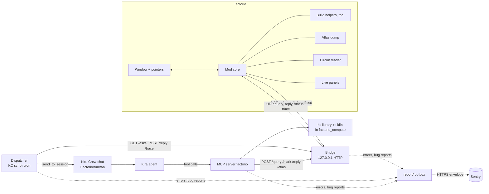

# Architecture overview

factorycrew lets a Factorio player ask Kira, a Kiro Crew agent, about the current game from a window inside the game. Kira reads the live save with Lua, answers in the window, marks places on the map, builds with ghosts and keeps live panels. The behaviour contract is [SPEC.md](../SPEC.md); each area below has its own doc in [areas/](areas/).

## Areas

| Area | What it does | Doc |
|---|---|---|
| Mod core | run, tabs, feed, marks and query execution in the game; UDP to the bridge | [mod-core.md](areas/mod-core.md) |
| In-game window and pointers | Kira's window, the `@1`/`@2` pointer tool | [window.md](areas/window.md) |
| Build helpers and trial runs | `kc.place_ghosts`, poles, power, `kc.trial_*` in the query environment | [build-helpers.md](areas/build-helpers.md) |
| Atlas | the base as a graph: structure dump in the mod, cache in the bridge, views in Python | [atlas.md](areas/atlas.md), design: [../atlas.md](atlas.md) |
| Circuits | circuit-network reader (Lua) and simulator (Python) | [circuits.md](areas/circuits.md), format: [circuits-format.md](circuits-format.md) |
| Live panels | in-game windows Kira writes once and the mod refreshes; the panel library | [panels.md](areas/panels.md) |
| Bridge | the only UDP peer of the game; HTTP API on 127.0.0.1 for everyone else | [bridge.md](areas/bridge.md) |
| Dispatcher | Kiro Crew script-cron: questions from the bridge into chats `Factorio/<run>/<tab>` | [dispatcher.md](areas/dispatcher.md) |
| MCP server | Kira's `factorio_*` tools; the `factorio_compute` sandbox | [mcp-server.md](areas/mcp-server.md) |
| kc library | Python building blocks Kira imports in `factorio_compute` | [kc-library.md](areas/kc-library.md) |
| Skills | Python planners (belts, pipes, power, mining, beacons, production, solar) | [skills.md](areas/skills.md) |
| Kira, the agent | the agent spec and her rules | [kira-agent.md](areas/kira-agent.md) |
| Error and bug reports | `report/`: automatic errors from every part and bug reports, through an outbox to Sentry | [reports.md](areas/reports.md), design: [sentry.md](sentry.md) |
| Kiro Crew app and releases | the package a player installs; the `release` branch | [app.md](areas/app.md) |
| Dev stands and test harness | per-worktree stacks, test scripts, CI | [dev-stand.md](areas/dev-stand.md), host rules: [worktrees.md](worktrees.md) |

## How they talk

1. The player asks in the window. The mod sends `ask` over UDP; the bridge acks and queues it ([mod-core](areas/mod-core.md), [bridge](areas/bridge.md)).
2. The dispatcher long-polls `GET /asks`, opens or finds the tab's chat and sends the question with a header line ([dispatcher](areas/dispatcher.md)).
3. Kira's turn calls `factorio_*` tools; the MCP server turns each into one HTTP call to the bridge, which sends a `query`/`mark`/`reply` to the game and returns the `result` ([mcp-server](areas/mcp-server.md)).
4. Heavier work runs off the game tick: `factorio_compute` runs Python with the kc library and skills in a sandbox ([kc-library](areas/kc-library.md), [skills](areas/skills.md)); `factorio_atlas` asks the bridge for the base's structure and builds the graph in the MCP process ([atlas](areas/atlas.md)).
5. `factorio_reply` ends the turn in the tab. Meanwhile the dispatcher follows the chat transcript and posts each step to `/trace`, so the window shows the turn as it runs.

## Where data lives

- In the save (`storage` of the mod): run id and name, tabs, the feed of each tab, marks, dirty atlas chunks, live panels ([mod-core](areas/mod-core.md), [panels](areas/panels.md)).
- In the bridge's memory: the ask queue and leases, the outbox for an offline game, the merged atlas structure per surface; nothing on disk ([bridge](areas/bridge.md)).
- In the gateway home (`~/.kirocrew-factorio*` for development, the app's `data/` for a player): `dispatch-state.json` (run and tab to chat), chat transcripts, Kira's agent file, saved panels as Kiro Crew artifacts ([dispatcher](areas/dispatcher.md), [app](areas/app.md)).
- In the MCP process: the parsed atlas per surface and run ([atlas](areas/atlas.md)).
- Error and bug reports: written to `<KIROCREW_HOME>/factorio/outbox/` and sent to Sentry in the background; a copy of every bug report stays in `<KIROCREW_HOME>/factorio/bug-reports/`. No automatic error carries the player's question or Kira's chat; only a bug report the player confirmed does ([reports](areas/reports.md)).

## Build and ship

- Development: each worktree runs its own stack with `scripts/stand.sh` ([dev-stand](areas/dev-stand.md), [worktrees.md](worktrees.md)). The fast check is `scripts/check.sh`; CI runs the same steps (`.github/workflows/check.yml`).
- Players: `scripts/build-app.sh` makes `dist/factorycrew/`, a Kiro Crew app with the mod, bridge, MCP server, dispatcher, Kira and skills; the Release workflow in GitHub Actions (`.github/workflows/release.yml`, run by hand or by a `v*` tag; it runs the unit tests, then `scripts/release.sh`) builds with Sentry environment `prod` and commits the app to the `release` branch (a `vX.Y.Z-test.N` tag goes to `release-staging`), which is the app registry players add ([app](areas/app.md)). The app copies the mod into Factorio's mods folder; nothing comes from the mod portal.

## Decisions

The repository owner's decisions, one entry each with its evidence: [decisions.md](decisions.md).
